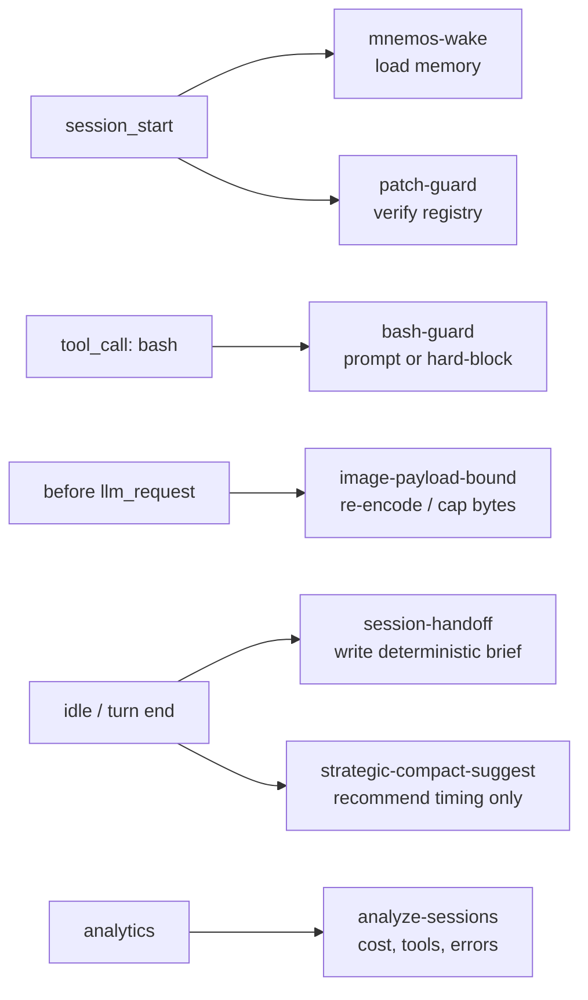

# Architecture

The harness exposes lifecycle hooks. Every piece here attaches to one of them; nothing runs as a separate daemon, and nothing owns a second copy of session state.

## Hook contract

| Hook | Piece | Guarantee |
|---|---|---|
| `session_start` | `mnemos-wake`, `patch-guard` | Runs before the first model call; never blocks the session on a missing file |
| `tool_call` (pre) | `bash-guard` | Returns allow / prompt / block, with a reason the model can read |
| `llm_request` (pre) | `image-payload-bound` | Total image bytes stay under budget; the newest image survives |
| turn end / idle | `session-handoff` | One file per session, overwritten, same input → same output |
| turn end / idle | `strategic-compact-suggest` | Advice only; no history rewrite |

## Why the handoff is extraction, not summarisation

A summary is lossy and non-reproducible: the same session can produce different text on two runs, and the next session cannot tell which claims were checked. The handoff instead parses the transcript's own records:

- the first line for session id, cwd and start time;
- the last user request;
- the files touched (from patch and read records);
- the commands run and their exit status;
- unresolved items the session itself marked as open.

That makes it auditable. If the brief says a test passed, the transcript contains the run that says so.

## Why the guards are split by mode

An interactive session can answer a dialog. A subagent cannot: its stdin is `/dev/null`. Asking a question there means hanging until timeout, so the subagent path hard-blocks a short list of unrecoverable operations and allows the rest. The mode is decided once, at registration, from the depth the subagent runtime injects.

## Why retirement is part of the design

A guard that outlives its condition becomes noise, and noise trains operators to click through prompts. Each retired guard documents the exact check that shows the condition is gone — an empty patch registry, a budget replaced upstream — so removal is a measurement, not a mood.
